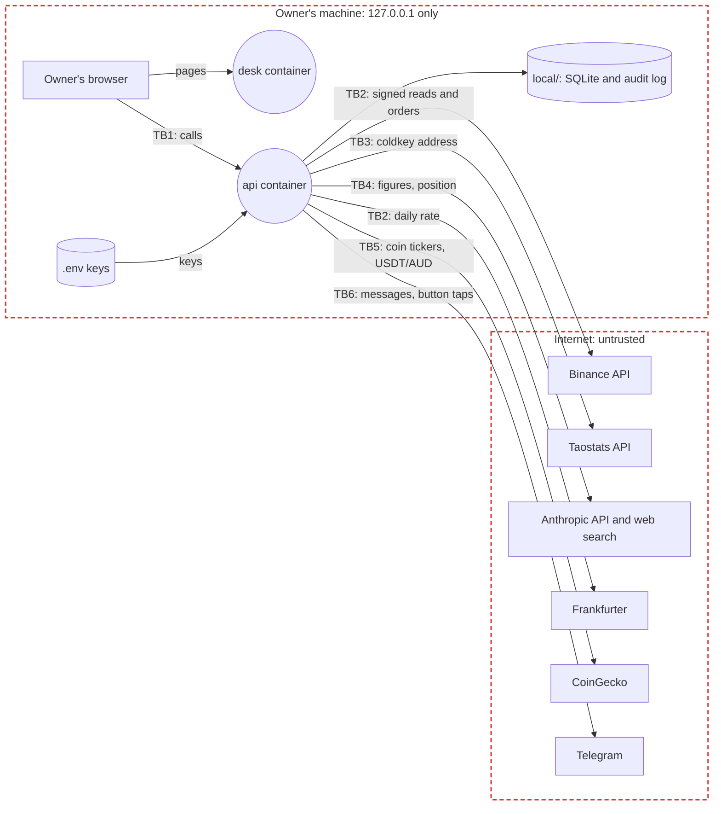

# Threat model

The desk on the owner's machine, in Docker; each later stage extends this first. STRIDE on the data flow below, mapped to OWASP Top 10:2025 (A), API Security 2023 (API), LLM 2025 (LLM) and Agentic 2026 (ASI).

## Data flow

Circles: processes; cylinders: stores; dashed boxes: trust boundaries.

| ID | Data | Class | Where |
|:-:|------|-------|-------|
| D1 | Binance key: read and spot trading | Secret | `.env` only |
| D2 | Anthropic, Taostats, Claude and Telegram credentials | Secret | `.env` |
| D3 | Balances, orders, trades, the TAO balance | Confidential | Fetched on demand |
| D4 | Watchlists, limits, bots, trades, plans, history | Internal | `local/desk.sqlite` |
| D5 | Audit log | Confidential | `local/audit.jsonl`, add-only |
| D6 | The TAO coldkey address | Internal (public on chain) | `.env`, sent to Taostats |

## Trust boundaries

In full: [threat-model/boundaries.md](threat-model/boundaries.md).

- **TB1** Browser to `api`: `127.0.0.1` only, no sign-in (decision 10); only the desk's origin, `Content-Type` checked on writes.
- **TB2** `api` to Binance and Frankfurter: TLS, Binance calls signed; replies parsed to a fixed shape.
- **TB3** `api` to Taostats: TLS, the public address only.
- **TB4** `api` to Anthropic, by API key or subscription (decision 48): figures, position and Profile, never keys or ids; replies schema-checked.
- **TB5** `api` to CoinGecko: tickers, never amounts; logos checked for host, type and size.
- **TB6** `api` to Telegram: the token only in the URL, never logged; messages, never keys, to the chat linked by code (decision 57); its one-use buttons place orders (decision 74, R12).
- **TB7** Freqtrade and `api`: one route in, job files out; nothing placed (decisions 84, 87). Held by the network, not headers: the Freqtrade containers sit on their own `bots` network, and the api answers only `POST /pot/judge-one` from its range whatever Host they send; their image is pinned by digest (audit 18).

## Top risks

STRIDE: Spoofing, Tampering, Repudiation, Information disclosure, Denial of service, Elevation of privilege.

| ID | Risk | STRIDE | OWASP | Rating | Controls | Enforced at |
|:-:|------|:------:|-------|:------:|----------|-------------|
| R1 | A web page in the owner's browser calls the local `api` (cross-site request) | S, E | A01, API2 | High | Ports on `127.0.0.1` only; CORS allows only the desk's origin; writes need `application/json`, forcing a preflight; limits and the kill switch apply *(planned)* | Code, Test |
| R2 | The `api` or `desk` is reachable from another machine | I, E | A05 | High | Compose publishes on `127.0.0.1` only, tested *(planned)* | Code, Test |
| R3 | A compromised package or image | T | A03, LLM03 | Medium | Pinned week-old versions, Dependabot, Trivy on push, PR and weekly | Code, Build, Operate |
| R4 | A secret committed | I | A07 | Medium | `.env` git-ignored; pre-push scan; push protection | Code |
| R5 | A key leaks via code, a log, the browser, a prompt or the agent | I, E | A02, A07 | High | Binance's trades spot only, from the owner's address; keys only in `.env`, never logged or sent on; Settings takes one once, never returning it (decisions 51, 57); the agent never reads one | Code, Operate |
| R6 | An order the owner didn't mean: a bug, a double submit, a bot overbuying, or a resent timed-out order | T, E | API6 | High | A confirm for each order and bot (off at first); per-order and daily limits (zero until set) and the kill switch, in code; a client id per order, recorded first, looked up after a timeout; a limit confirmed cancelled before a market buy replaces it; bots pause on a Binance error (decisions 18, 37 to 43, 47, 72, 84) | Code, Test, Operate |
| R7 | A searched page steers the plan (prompt injection), or the model is wrong | T | LLM01, LLM09 | Medium | The AI only advises (spec 10): nothing it calls trades; levels from code; its JSON schema-checked and held to the owner's risk rules (decisions 16, 46) | Code, Test |
| R8 | The AI runs up the bill | D | LLM10 | Medium | A cache, scheduled runs fixed in code, the monthly cap checked before each call, a Console limit (costs 6) | Code, Operate |
| R9 | An action can't be traced | R | A09 | Medium | The add-only audit log | Code |
| R10 | Outside text runs as markup | T | A05 | Low | Fixed-shape parsing; React escapes text; a content security policy *(planned)* | Code |
| R11 | TradingView's widget, or a fake, acts on the desk | T, I | A08 | Low | Framed from TradingView's own origin, the only one the policy allows; none of its scripts run on the desk (decision 22) | Code |
| R12 | A stolen or replayed Telegram button places an order | S, T, E | API2, ASI03 | High | A random token per button, used once, void after expiry; taps only from the owner's linked chat (known-mistakes 29c); a tap runs the desk's own code, so limits, kill switch and rule checks apply; logged (decision 74) | Code, Test |

## Compliance

- None while it trades only its owner's money; before anyone else uses it, a lawyer checks licensing and AUSTRAC registration (decision 6).
