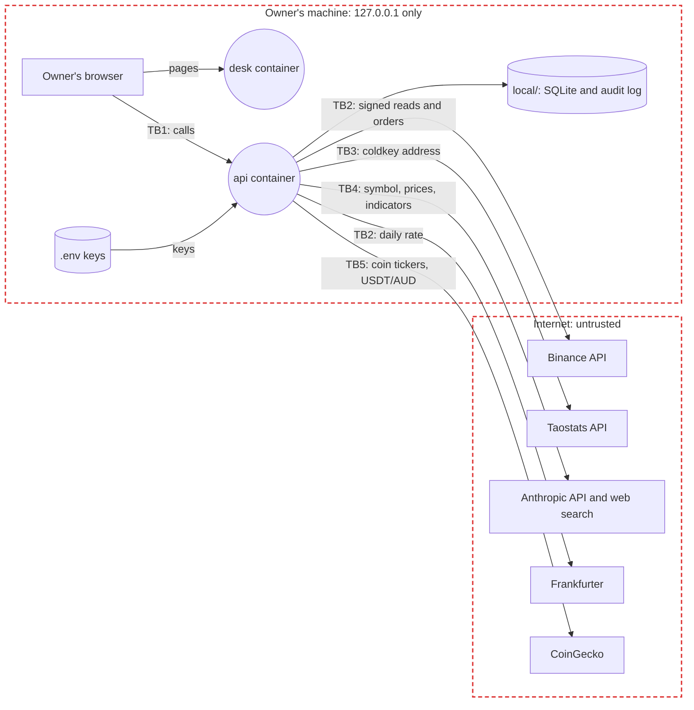

# Threat model

The MVP: an AI-native trading desk on the owner's machine, in Docker: a Binance and TAO wallet portfolio, AI signals for a watchlist, and spot limit orders, for one owner. Each later stage extends it before it ships. STRIDE on the data flow below; each risk maps to the OWASP lists that fit the app: Top 10:2025 (A), API Security Top 10:2023 (API), LLM Top 10:2025 (LLM) and Agentic Top 10:2026 (ASI).

## Data flow

Rectangles are external entities, circles processes, cylinders data stores, red dashed boxes trust boundaries; TB labels mark the flows that cross a boundary.

| ID | Data | Class | Where |
|:-:|------|-------|-------|
| D1 | Binance API key and secret: read and spot trading, no withdrawal | Secret | `.env` only (spec 10) |
| D2 | Anthropic and Taostats API keys | Secret | `.env` only |
| D3 | Balances, orders, trades and the TAO wallet's balance | Confidential | Fetched on demand; the browser on the same machine |
| D4 | Watchlist, limits, kill switch, smart trades, signals, account value history | Internal | `local/desk.sqlite` |
| D5 | Audit log | Confidential | `local/audit.jsonl`, add-only |
| D6 | The TAO coldkey address | Internal (public on chain) | `.env`, sent to Taostats |

## Trust boundaries

- **TB1** Browser to `api`: both containers publish on `127.0.0.1` only, so only the owner's machine reaches them. There's no sign-in (decision 10), so any process or web page on the machine is a possible caller: the `api` allows only the desk's origin and checks `Content-Type` on every write.
- **TB2** `api` to Binance and Frankfurter: over TLS; Binance calls are signed. What comes back is untrusted, parsed against a fixed shape and shown as text.
- **TB3** `api` to Taostats: over TLS, sending only the public address.
- **Binance deposit history** (decision 31): the api reads the USDC deposit history with the same read-only key, and keeps what the owner paid per deposit in the local SQLite under `local/`, git-ignored. The owner's figures never go in tests, demo data or docs (known-mistakes 7).
- **Fear & Greed Index** (decision 36): the api asks `api.alternative.me` for the index, with no account data, at most every 10 minutes, and checks the value is 0 to 100.
- **Fear & Greed details and market size** (decision 42): the api asks `api.alternative.me` for a year of the index and CoinGecko's `/global` for the market's size, volume and dominance (also for the header, decision 44), with no account data, kept 10 minutes; what comes back is checked and shown as numbers and fixed words.
- **TB5** `api` to CoinGecko: sends a coin's ticker once to find its logo, so CoinGecko can see which coins the desk shows, never amounts. Logos are taken only from CoinGecko's image host, only as PNG, JPEG or WebP (never SVG), up to 256 KB, and kept in `local/icons/`. Each portfolio refresh also asks CoinGecko for USDT's price in AUD and INR (decisions 29, 30): no account data is sent, and a reply outside 0.8 to 3 is ignored for the ECB's rate.
- **TB4** `api` to Anthropic: sends a coin's computed figures and the owner's position in it (amount, average cost, PnL, share, cash, the portfolio's total value, open orders' side, price and amount: decision 46), never keys, account ids or order ids. What comes back, including text from web pages it searched, is untrusted: checked against a fixed shape and shown as text.

## Top risks

STRIDE: Spoofing, Tampering, Repudiation, Information disclosure, Denial of service, Elevation of privilege.

| ID | Risk | STRIDE | OWASP | Rating | Controls | Enforced at |
|:-:|------|:------:|-------|:------:|----------|-------------|
| R1 | A web page open in the owner's browser calls the local `api` and places an order (cross-site request) | S, E | A01, API2 | High | Ports on `127.0.0.1` only; CORS allows only the desk's origin; writes need `application/json`, which a cross-site form can't send without a preflight; orders still need limits and the kill switch (spec 10) *(planned)* | Code, Test |
| R2 | The `api` or `desk` is reachable from the network | I, E | A05 | High | Compose publishes `127.0.0.1:port` only, with a test that reads the compose file *(planned)* | Code, Test |
| R3 | A compromised package or image | T | A03, LLM03 | Medium | Pinned week-old versions, pinned base images, Dependabot, Trivy on every push and PR and weekly | Code, Build, Operate |
| R4 | A secret is committed | I | A07 | Medium | `.env` ignored by git, the pre-push scan, GitHub push protection | Code |
| R5 | A key leaks, through code, a log, the browser, a prompt or the agent | I, E | A02, A07 | High | Binance's can't withdraw or use margin or futures and works only from the owner's address; keys live only in `.env`, read by the `api` alone, never logged or sent to the browser or Claude (spec 10); the agent never reads one (decision 2) | Code, Operate |
| R6 | An order the owner didn't mean: a bug, a double submit, a prefilled price taken on trust, or a DCA or grid bot that buys more than meant | T, E | API6 | High | Limit orders only, after a confirm step that states the order in words; a bot only after a confirm that states every order it may place and the total, simultaneous deals included, created off; per-order and daily limits (bot buys count towards the day), zero until set, and the kill switch, which stops every bot and cancels their buys, checked in code; one idempotency key per order, and per DCA and ladder rung, a ladder checked whole before any rung is sent, recorded before it's sent; a bot pauses on a Binance error (spec 10, decisions 18, 37 to 43); an edited order keeps the same limits and can't touch a bot's or smart trade's order; a smart trade's stop loss and Close sell at market, the one market order, and only take risk away | Code, Test, Operate |
| R7 | Text on a web page Claude searches steers the signal (indirect prompt injection), or the model is simply wrong | T | LLM01, LLM09 | Medium | The signal only advises (spec 10): it can't call anything that trades, its output is checked against a fixed shape, numbers it suggests are clamped to within 20% of the price, and the panel shows its reasons and confidence for the owner to judge (decision 16) *(planned)* | Code, Test |
| R8 | The AI signal runs up the Anthropic bill | D | LLM10 | Medium | A 4-hour cache, signals only on add and Re-run, the monthly cap checked in code, and a spend limit in the Anthropic Console (costs 6) *(planned)* | Code, Operate |
| R9 | An action can't be traced afterwards | R | A09 | Medium | The add-only audit log, with every exchange call, signal and order (spec 10) | Code |
| R10 | Text from an exchange, Taostats or Claude runs as markup in the browser | T | A05 | Low | Responses parsed to a fixed shape; React escapes text; a content security policy *(planned)* | Code |
| R11 | TradingView's chart widget, or a page posing as it, acts on the desk | T, I | A08 | Low | Framed from TradingView's own widget site, another origin, so the browser keeps it from this page and its api (which refuses other origins); no TradingView script runs on the desk; the page's policy allows framing that one site only (decision 22) | Code |

## Compliance

- None while the desk trades only its owner's money. Tax records are the owner's own job. Before anyone else uses it: an Australian financial services licence and AUSTRAC registration are checked with a lawyer (decision 6).
