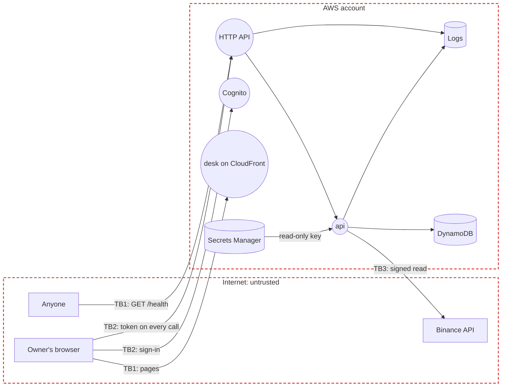

# Threat model

The MVP: a read-only view of one Binance account, for one owner. Each later stage extends it before it ships. STRIDE on the data flow below; each risk maps to the OWASP lists that fit the app: Top 10:2025 (A), API Security Top 10:2023 (API), LLM Top 10:2025 (LLM) and Agentic Top 10:2026 (ASI).

## Data flow

Rectangles are external entities, circles processes, cylinders data stores, red dashed boxes trust boundaries; TB labels mark the flows that cross a boundary.

| ID | Data | Class | Where |
|:-:|------|-------|-------|
| D1 | Access logs: caller IP, route, status | Internal | CloudWatch, kept 30 days |
| D2 | Binance API key and secret, read-only | Secret | Secrets Manager only (spec 10) |
| D3 | Balances, orders and trades | Confidential | DynamoDB, encrypted; the browser while signed in |
| D4 | Audit log | Confidential | DynamoDB, add-only |
| D5 | The owner's sign-in: email, password hash, authenticator secret | Confidential | Cognito |

## Trust boundaries

- **TB1** Internet to AWS: `/health` takes no sign-in, so everything a caller sends is untrusted.
- **TB2** Browser to AWS: the owner signs in to Cognito with a password and an authenticator code, and the HTTP API checks the token on every other route (spec 9). Sign-up is off.
- **TB3** AWS to Binance: the `api` calls out over TLS and signs each request; what comes back is untrusted, so it's parsed against a fixed shape and shown as text.

## Top risks

STRIDE: Spoofing, Tampering, Repudiation, Information disclosure, Denial of service, Elevation of privilege.

| ID | Risk | STRIDE | OWASP | Rating | Controls | Enforced at |
|:-:|------|:------:|-------|:------:|----------|-------------|
| R1 | A flood of requests to the public route runs up the bill | D | API4 | Low | Throttling on every route, the budget emails when set (costs 10) | Deploy, Operate |
| R2 | The public route leaks something from the request or the service | I | A01, API3 | Low | It returns a fixed body (spec 9), with a test that it echoes nothing | Code, Test |
| R3 | A new route ships without sign-in | S, E | A01, API2 | Medium | Authorisation on every request (code-standards 10); Checkov fails a route with no authorisation | Code, Build |
| R4 | A compromised package or image | T | A03, LLM03 | Medium | Pinned week-old versions, SHA-pinned allowed actions only, Dependabot, Trivy on every push and PR and weekly | Code, Build, Operate |
| R5 | A secret is committed | I | A07 | Medium | The pre-push scan, GitHub push protection, OIDC with no long-lived keys | Code, Deploy |
| R6 | The exchange key leaks, through code, state, a log or the agent | I, E | A02, A07 | High | The key can only read and never withdraw, lives only in Secrets Manager, readable by the `api` role alone (spec 10); the agent never reads it (decision 2); nothing secret in Terraform (decision 5) *(planned)* | Code, Deploy |
| R7 | Someone else signs in and sees the portfolio | S, I | A07, API2 | Medium | One user, no sign-up, multi-factor sign-in, short-lived tokens checked on every route (spec 9) *(planned)* | Deploy, Test |
| R8 | A later stage's key places orders the owner didn't want: a bug, a runaway bot or a stolen key | T, E | API6 | High, from the manual trades stage | No trading key exists yet (decision 1). Before one does: the fixed IP address, order and daily limits in code, and the kill switch (spec 10) *(planned)* | Code, Operate |
| R9 | An action can't be traced afterwards | R | A09 | Medium | The add-only audit log (spec 10), CloudTrail for the account *(planned)* | Code, Monitor |
| R10 | Text from the exchange, such as an asset name, runs as markup in the browser | T | A05 | Low | Responses parsed to a fixed shape; React escapes text; a content security policy *(planned)* | Code |

## Compliance

- None while the desk trades only its owner's money. Tax records are the owner's own job. Before anyone else uses it: an Australian financial services licence and AUSTRAC registration are checked with a lawyer (decision 6).
