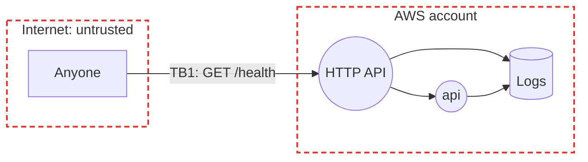

# Threat model

A starter: the model of the sample the template ships, for kickoff to extend. STRIDE on the data flow below; each risk maps to the OWASP lists that fit the app: Top 10:2025 (A), API Security Top 10:2023 (API), LLM Top 10:2025 (LLM) and Agentic Top 10:2026 (ASI). Optional: delete it if the project has no users, data or secrets to protect; a prototype has one only if asked.

## Data flow

Rectangles are external entities, circles processes, cylinders data stores, red dashed boxes trust boundaries; TB labels mark the flows that cross a boundary.

| ID | Data | Class | Where |
|:-:|------|-------|-------|
| D1 | Access logs: caller IP, route, status | Internal | CloudWatch, kept 30 days |
| D2 | *(to fill in)* each kind of data the project holds | | |

## Trust boundaries

- **TB1** Internet to AWS: `/health` takes no sign-in, so everything a caller sends is untrusted. *(to fill in)* how users sign in, once there are any, and a TB line for each further boundary, such as model output or an outside service.

## Top risks

STRIDE: Spoofing, Tampering, Repudiation, Information disclosure, Denial of service, Elevation of privilege.

| ID | Risk | STRIDE | OWASP | Rating | Controls | Enforced at |
|:-:|------|:------:|-------|:------:|----------|-------------|
| R1 | A flood of requests to the public route runs up the bill | D | API4 | Low | Throttling on every route, the budget emails when set (costs 5) | Deploy, Operate |
| R2 | The public route leaks something from the request or the service | I | A01, API3 | Low | It returns a fixed body (spec 9), with a test that it echoes nothing | Code, Test |
| R3 | A new route ships without sign-in | S, E | A01, API2 | Medium | Authorisation on every request (code-standards 10); Checkov fails a route with no authorisation | Code, Build |
| R4 | A compromised package or image | T | A03, LLM03 | Medium | Pinned week-old versions, SHA-pinned allowed actions only, Dependabot, Trivy on every push and PR and weekly | Code, Build, Operate |
| R5 | A secret is committed | I | A07 | Medium | The pre-push scan, GitHub push protection, OIDC with no long-lived keys | Code, Deploy |
| R6 | *(to fill in)* the project's own risks, each written like those above: its STRIDE letters, OWASP IDs, a rating, controls that cite a spec or code-standards number, and where each is enforced; mark a control not yet built *(planned)* | | | | | |

## Compliance

- *(to fill in)* one line for each law in `spec.md`'s Business section: what it requires here and by when, or none.
