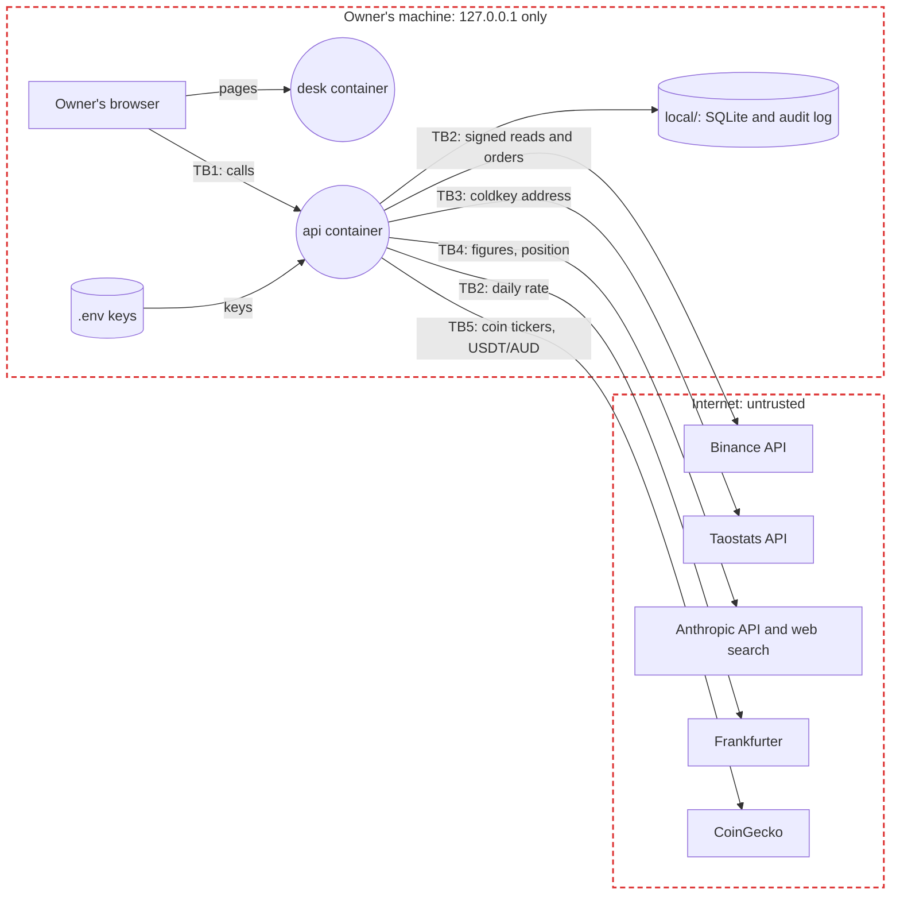

# Threat model

The desk on the owner's machine, in Docker; each later stage extends this before it ships. STRIDE on the data flow below, mapped to OWASP Top 10:2025 (A), API Security 2023 (API), LLM 2025 (LLM) and Agentic 2026 (ASI).

## Data flow

Circles are processes, cylinders data stores, red dashed boxes trust boundaries; TB labels mark flows that cross one.

| ID | Data | Class | Where |
|:-:|------|-------|-------|
| D1 | Binance key: read and spot trading | Secret | `.env` only |
| D2 | Anthropic and Taostats keys; the Claude subscription token | Secret | `.env` only |
| D3 | Balances, orders, trades, the TAO balance | Confidential | Fetched on demand |
| D4 | Watchlists, limits, bots, trades, plans, history | Internal | `local/desk.sqlite` |
| D5 | Audit log | Confidential | `local/audit.jsonl`, add-only |
| D6 | The TAO coldkey address | Internal (public on chain) | `.env`, sent to Taostats |

## Trust boundaries

In full, with other read-only sources: [threat-model/boundaries.md](threat-model/boundaries.md).

- **TB1** Browser to `api`: `127.0.0.1` only, no sign-in (decision 10); the `api` allows only the desk's origin and checks `Content-Type` on every write.
- **TB2** `api` to Binance and Frankfurter: TLS, Binance calls signed; replies untrusted, parsed to a fixed shape.
- **TB3** `api` to Taostats: TLS, the public address only.
- **TB4** `api` to Anthropic, by API key or the owner's subscription via Claude Code, which only searches and gets no other secret (decision 48): a coin's figures and the owner's position (decision 46), never keys or ids; replies schema-checked.
- **TB5** `api` to CoinGecko: tickers for logos and rates, never amounts; logos checked for host, type and size.

## Top risks

STRIDE: Spoofing, Tampering, Repudiation, Information disclosure, Denial of service, Elevation of privilege.

| ID | Risk | STRIDE | OWASP | Rating | Controls | Enforced at |
|:-:|------|:------:|-------|:------:|----------|-------------|
| R1 | A web page in the owner's browser calls the local `api` (cross-site request) | S, E | A01, API2 | High | Ports on `127.0.0.1` only; CORS allows only the desk's origin; writes need `application/json`, which forces a preflight; limits and the kill switch still apply *(planned)* | Code, Test |
| R2 | The `api` or `desk` is reachable from another machine | I, E | A05 | High | Compose publishes on `127.0.0.1` only, tested *(planned)* | Code, Test |
| R3 | A compromised package or image | T | A03, LLM03 | Medium | Pinned week-old versions and base images, Dependabot, Trivy on every push, PR and week | Code, Build, Operate |
| R4 | A committed secret | I | A07 | Medium | `.env` git-ignored; pre-push scan; push protection | Code |
| R5 | A key leaks through code, a log, the browser, a prompt or the agent | I, E | A02, A07 | High | Binance's can't withdraw or use margin or futures, and works only from the owner's address; keys live only in `.env`, read by the `api` alone, never logged or sent on (spec 10); the agent never reads one (decision 2) | Code, Operate |
| R6 | An order the owner didn't mean: a bug, a double submit, a bot buying more than meant, or a timed-out order resent | T, E | API6 | High | A confirm step in words for every order and every bot (which starts off); per-order and daily limits, zero until set, and the kill switch, checked in code; an idempotency key per order and rung, recorded before it's sent; a timed-out order looked up by its client id, never assumed lost; a bot pauses on a Binance error; market orders only to sell, taking risk away (decisions 18, 37 to 43, 47) | Code, Test, Operate |
| R7 | A searched web page steers the plan (indirect prompt injection), or the model is wrong | T | LLM01, LLM09 | Medium | The plan only advises (spec 10): it can't call anything that trades; it picks levels computed in code, its JSON is checked against a per-call schema and held to the owner's risk rules, and the panel shows its reasons (decisions 16, 46) *(planned)* | Code, Test |
| R8 | The AI signal runs up the Anthropic bill | D | LLM10 | Medium | A cache, runs when asked, the monthly cap in code, a Console spend limit (costs 6) *(planned)* | Code, Operate |
| R9 | An action can't be traced | R | A09 | Medium | The add-only audit log (spec 10) | Code |
| R10 | Outside text runs as markup | T | A05 | Low | Fixed-shape parsing; React escapes text; a content security policy *(planned)* | Code |
| R11 | TradingView's widget, or a fake, acts on the desk | T, I | A08 | Low | Framed from TradingView's widget site, another origin, so the browser keeps it from the desk and its api; no TradingView script runs on the desk; the policy allows framing that site only (decision 22) | Code |

## Compliance

- None while the desk trades only its owner's money; tax records are the owner's job. Before anyone else uses it, a lawyer checks licensing and AUSTRAC registration (decision 6).
